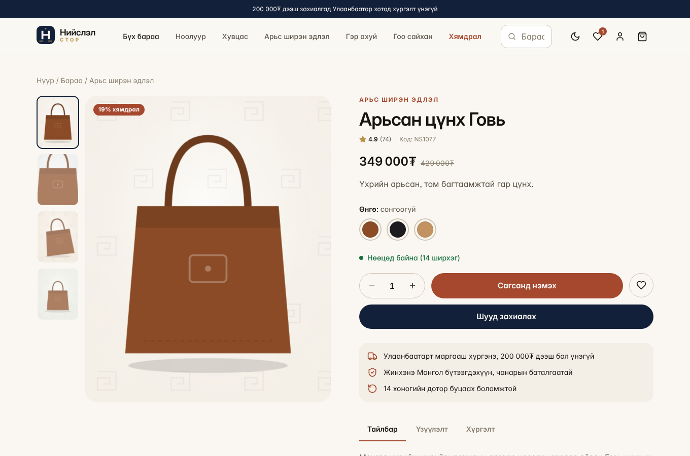
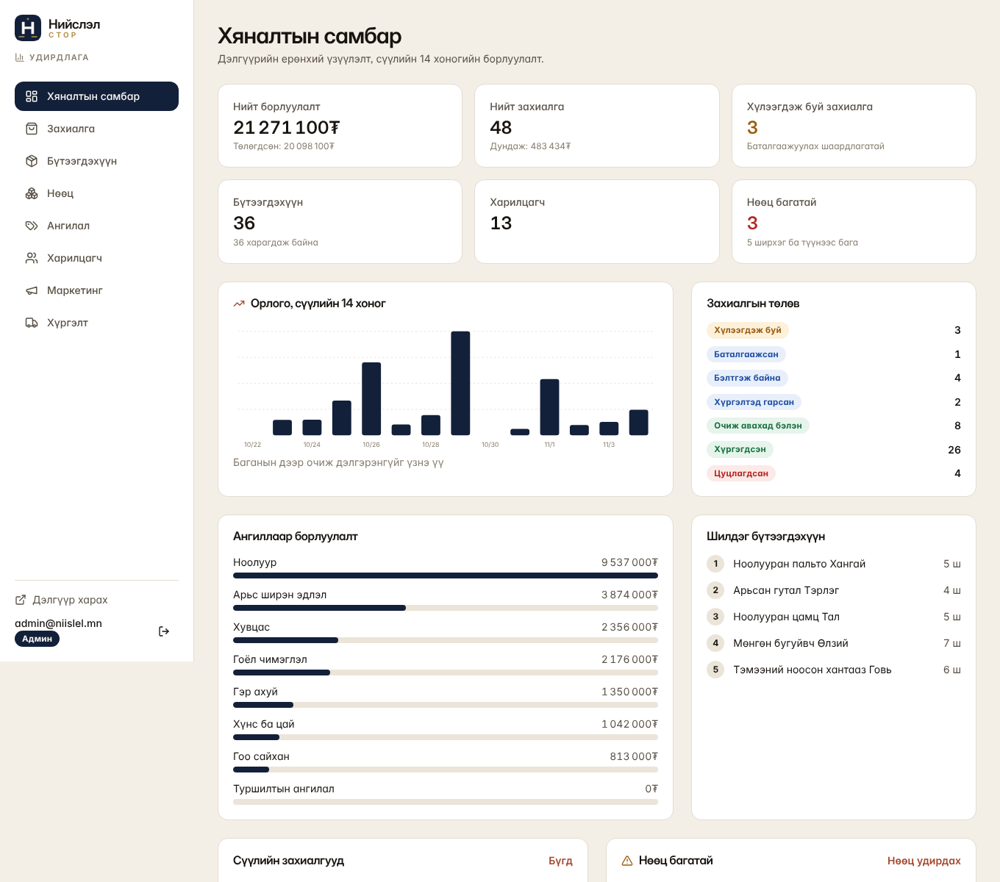

# Нийслэл Стор

Монголын зах зээлд зориулсан бүрэн ажиллагаатай онлайн дэлгүүрийн платформ. Энэ нь бие даасан төсөл бөгөөд Next.js 15, TypeScript, Tailwind v4 дээр бүтсэн. GitHub болон Vercel дээр шууд байршуулж болно.


## Чухал анхааруулга

* Төлбөрийн бүх арга (QPay, SocialPay, банкны шилжүүлэг, хүргэлтээр төлөх) ДЕМО хэлбэрээр дүрслэгдсэн. Бодит гүйлгээ хийгдэхгүй. QR код сканнердагдахгүй.
* Supabase холболтын хэрэгжүүлэлт (`SupabaseRepository`) хараахан бичигдээгүй. Одоо байгаа зүйл нь `supabase/schema.sql` (хүснэгт, RLS, `place_order` функц) болон `StoreRepository` интерфэйс юм.
* Демо горимд өгөгдөл хөтчийн localStorage дээр хадгалагддаг тул хэрэглэгч бүр өөр өөрийн хуулбарыг харна. Харилцагчийн нэвтрэлт нь зөвхөн демо зориулалттай.
* Админ нэвтрэлт нь server талд гарын үсэгтэй HttpOnly cookie ашигладаг боловч админы өгөгдөл демо горимд localStorage дээр байгаа.

## Боломжууд

* Нүүр хуудас, 36 бүтээгдэхүүнтэй каталог, хайлт, шүүлтүүр, эрэмбэлэлт, хуудаслалт
* Бүтээгдэхүүний дэлгэрэнгүй: галерей, өнгө, хэмжээ, үлдэгдэл, хүслийн жагсаалт, төстэй бүтээгдэхүүн
* Хадгалагддаг сагс, купон, хүргэлтийн төлбөр, нийт дүн
* Захиалга өгөх, захиалгын дугаар, Улаанбаатарын дүүрэг тус бүрийн хүргэлт (энгийн, шуурхай, очиж авах), төлөв хянах
* Бүртгэл, нэвтрэлт, хаяг, захиалгын түүх, тохиргоо
* Админ самбар: үзүүлэлт, график, бүтээгдэхүүн, ангилал, нөөц, захиалга, харилцагч, купон, баннер, хүргэлтийн тохиргоо
* Эрхийн ялгаа: админ ба ажилтан (middleware дээр server талд шалгана)
* Хар ба цагаан загвар, гар утсанд зохицсон дизайн

## Ажиллуулах

```bash
npm install
cp .env.example .env.local
npm run dev
```

http://localhost:3000 хаягаар нээнэ.

### Демо бүртгэл

| Төрөл | Имэйл | Нууц үг |
| --- | --- | --- |
| Админ | admin@niislel.mn | Admin#2026demo |
| Ажилтан | staff@niislel.mn | Staff#2026demo |
| Харилцагч | demo@niislel.mn | demo1234 |

Админ бүртгэл нь `NEXT_PUBLIC_DEMO_MODE` нь "false" биш бөгөөд `ADMIN_EMAIL` тохируулаагүй үед л ажиллана. Production дээр `.env.example` дахь `SESSION_SECRET`, `ADMIN_EMAIL`, `ADMIN_PASSWORD` утгуудыг заавал өөрөө тохируулна.

## Тест

```bash
npm run typecheck
npm test            # 33 нэгжийн тест
npm run build && npm run test:e2e   # 89 шалгалттай хөтчийн аялал (Playwright)
```

E2E аялал нь дэлгүүрээс админ хүртэлх бүх урсгалыг, үүнд нөөц буурах ба сэргэхийг шалгана.

## Байршуулах (Vercel)

1. Репог GitHub дээр push хийнэ.
2. Vercel дээр "Add New Project" сонгож репогоо холбоно. Framework автоматаар Next.js гэж танигдана.
3. Environment Variables хэсэгт `.env.example` доторх хувьсагчдыг оруулна. `SESSION_SECRET` дор хаяж 32 тэмдэгт байна.
4. Deploy дарна.

Нууц түлхүүрүүдийг (`SUPABASE_SERVICE_ROLE_KEY`, төлбөрийн credential) хэзээ ч `NEXT_PUBLIC` угтвартай болгож болохгүй.

## Архитектур

* `src/lib/data/repository.ts`: өгөгдлийн цорын ганц гэрээ. UI зөвхөн үүгээр дамжина.
* `src/lib/data/local-repository.ts`: демо хэрэгжүүлэлт. Захиалга өгөхдөө үлдэгдэл, үнэ, купон, хүргэлтийг дахин тооцож, таарахгүй бол татгалзана.
* `src/lib/pricing.ts`: үнэ, купон, хүргэлтийн тооцоо.
* `src/lib/payments/`: `PaymentProvider` интерфэйс, демо хэрэгжүүлэлт, `registry.ts`.
* `src/middleware.ts` ба `src/lib/admin-auth.ts`: админ хамгаалалт.
* `supabase/schema.sql`: хүснэгт, enum, RLS, `place_order` функц.

## Бодит төлбөр холбох

1. QPay эсвэл SocialPay-тэй албан ёсны гэрээ байгуулж credential авна.
2. `src/lib/payments/types.ts` дахь `PaymentProvider` интерфэйсийг хэрэгжүүлсэн класс бичнэ. Invoice үүсгэх, төлөв шалгах үүргийг server route дээр гүйцэтгэнэ.
3. `src/lib/payments/registry.ts` дотор демо классыг шинэ классаар солино.
4. Төлбөрийн callback дээр гарын үсгийг шалгаж, захиалгын төлвийг server талд шинэчилнэ.

## Supabase руу шилжүүлэх

1. Supabase төсөл үүсгэж `supabase/schema.sql` файлыг SQL editor дээр ажиллуулна.
2. `.env.local` дотор `NEXT_PUBLIC_SUPABASE_URL`, `NEXT_PUBLIC_SUPABASE_ANON_KEY`, `SUPABASE_SERVICE_ROLE_KEY` утгуудыг оруулна.
3. `StoreRepository` интерфэйсийг хэрэгжүүлэх `SupabaseRepository` бичиж `src/lib/data/index.ts` дотор холбоно. Захиалгыг `place_order` функцээр дамжуулбал нөөцийн шалгалт өгөгдлийн сан дээр атомаар хийгдэнэ.
4. Админ нэвтрэлтийг Supabase Auth ба `profiles.role` рүү шилжүүлнэ.

## Мэдэгдэж буй хязгаарлалт

* `SupabaseRepository` байхгүй. Одоогоор бүх өгөгдөл localStorage дээр.
* Нэвтрэх оролдлогын хязгаар нь серверийн санах ойд хадгалагддаг тул олон instance дээр хуваагдан ажиллана. Production дээр Redis зэрэг нэгдсэн хадгалалт хэрэгтэй.
* Бүтээгдэхүүний зураг нь SVG дүрслэл. Зураг оруулах хэсэг нь демо горимд хөтөч дээр хадгалагдана.

## Бичгийн дүрэм

Сайтын харагдах бүх текстэд үг хоорондын зураас, тире ашиглахгүй. Мөн Ө, Ү үсэг бүрэн дэмжигдсэн фонт (Inter) ашиглана. `tests/unit/copy.test.ts` тест үүнийг автоматаар шалгана.



